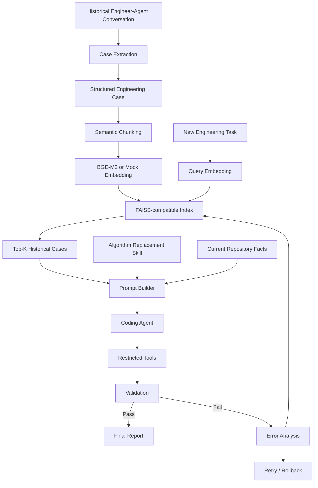

# Algorithm Upgrade RAG Agent Demo

This repository is a sanitized educational reproduction of an engineering workflow for AI-assisted algorithm integration. It demonstrates how historical engineer-agent interactions can be converted into reusable structured knowledge and retrieved during future coding tasks. All source code, logs, configurations, and data in this repository are synthetic and created solely for demonstration.

## Why this project?

Complex algorithm upgrades often fail for reasons that are not visible from the target file alone: downstream interface assumptions, configuration switches, validation gaps, and rollback requirements. This demo shows how a Coding Agent can reuse historical engineering experience through RAG while still validating every assumption against the current code.

## Problem

The toy algorithm pipeline is:

```text
Input Image -> PreProcess -> DRE -> ColorTransform -> Output
```

The old `OldDRE` algorithm returns:

```python
{"image": ..., "residual_map": ..., "metadata": ...}
```

The new `NewLLF` algorithm initially returns:

```python
{"image": ..., "metadata": ...}
```

`ColorTransform` still requires `residual_map`, so the Agent must add an adapter instead of directly replacing the algorithm.

## Architecture



## From Conversation to Structured Case

Raw chat logs contain false starts, repeated context, and temporary wrong conclusions. This project first converts a conversation into a structured `EngineeringCase`, then chunks only reusable knowledge:

- `task`
- `constraint`
- `solution`

That makes retrieval more precise and easier to explain.

## RAG Pipeline

The default mode uses `MockEmbeddingProvider`, a deterministic offline embedding that keeps tests stable. It is only for demonstration and does not represent true semantic embedding quality.

The full mode can use `BAAI/bge-m3` through `FlagEmbedding` and a FAISS `IndexFlatIP` index.

## Agent Skill

`examples/skills/algorithm_replacement.md` describes how the Agent should execute an algorithm replacement. RAG answers "what does the Agent know?", while the Skill answers "how should the Agent work?"

Historical cases are reference data. The current repository is the source of truth. The Agent must validate every assumption.

## Validation Loop

The demo validates five things:

- Interface output contains `image`, `residual_map`, and `metadata`
- Build check passes through `compileall`
- Runtime pipeline completes
- Algorithm switch is proven by `metadata.algorithm == "new_llf"`
- Rollback can restore `old_dre`

Build success alone is not enough: code can compile while still running the old algorithm.

## Failure Recovery Demo

`demo-failure` intentionally performs the wrong direct replacement first through the controlled executor:

```text
Historical cases -> RAG retrieval -> planner -> executor
-> validation failure -> error retrieval -> repair planner -> executor
-> success or rollback
```

This shows RAG being used again after a concrete execution failure, not only at task start.

## Quick Start

```bash
python -m venv .venv
source .venv/bin/activate
pip install -r requirements-lite.txt
python -m algo_rag_demo.cli build-index
python -m algo_rag_demo.cli search "Replace DRE while keeping downstream interface compatible"
python -m algo_rag_demo.cli demo-failure
pytest -q
```

## Reproducible Demo

For the low-friction teaching demo that does not require network access or an LLM API key:

```bash
bash scripts/run_teaching_demo.sh
```

This runs tests, rebuilds the mock vector index, executes the intentional failure, retrieves the error-specific historical case, applies the controlled repair, validates the result, and writes a new timestamped directory under `outputs/runs/`. Use this path first when explaining the project.

For the full live version with BGE-M3 semantic vectors and DeepSeek planning:

```bash
source ./load_deepseek_env.sh
bash scripts/run_live_demo.sh
```

`scripts/run_repro_demo.sh` is kept as a compatibility wrapper for parameterized runs:

```bash
bash scripts/run_repro_demo.sh mock mock
bash scripts/run_repro_demo.sh bge-m3 deepseek
```

On Windows PowerShell:

```powershell
python -m venv .venv
.\.venv\Scripts\Activate.ps1
pip install -r requirements-lite.txt
python -m algo_rag_demo.cli demo-failure
```

For BGE-M3 mode:

```bash
pip install -r requirements.txt
python -m algo_rag_demo.cli build-index --provider bge-m3
```

## LLM Case Extraction with DeepSeek

The offline demo keeps `RuleBasedCaseExtractor` as the default so tests can run without any API key. For LLM extraction, set DeepSeek credentials in your shell rather than committing them:

```bash
export DEEPSEEK_API_KEY="your_api_key"
export DEEPSEEK_BASE_URL="https://api.deepseek.com"
export DEEPSEEK_MODEL="deepseek-flash"
python -m algo_rag_demo.cli extract-case --extractor deepseek --raw examples/data/raw/conversation_dre_upgrade.json
```

To process every synthetic raw conversation:

```bash
python -m algo_rag_demo.cli extract-case --extractor deepseek --all
```

The extractor uses an OpenAI-compatible chat completion interface and asks the model to return one sanitized `EngineeringCase` JSON object. Do not store real secrets, company internals, customer data, or private logs in raw conversations.

## LLM Planning with DeepSeek

`MockPlanner` remains the default so the demo is deterministic and API-free. To let DeepSeek generate the repair plan from retrieved RAG evidence, pass `--planner deepseek`:

```bash
source ./load_deepseek_env.sh
python -m algo_rag_demo.cli demo-failure --provider mock --planner deepseek
```

For real semantic retrieval and LLM planning together:

```bash
source ./load_deepseek_env.sh
python -m algo_rag_demo.cli build-index --provider bge-m3
python -m algo_rag_demo.cli demo-failure --provider bge-m3 --planner deepseek
```

The LLM planner returns both readable plan text and an `executable_plan.steps` list. `PlanExecutor` treats those steps as intent, maps patches to safe templates, and executes them only through `ToolRegistry`. A failed validation is converted into a new retrieval query, DeepSeek generates a repair plan from the error-specific evidence, and the executor reruns the repair. Each run writes auditable artifacts such as `initial_retrieval.json`, `initial_plan.json`, `initial_execution.json`, `retrieval.json`, `plan.json`, `repair_execution.json`, `validation.json`, and `final_report.json`.

File edits still go through the fixed `ToolRegistry`, and validation checks interface compatibility, build status, runtime behavior, algorithm switch evidence, and rollback.

## Demo vs Reusable Code

The teaching storyline is isolated in `algo_rag_demo/demo_scenarios/dre_failure_recovery.py`. It owns the fixed user task, the intentionally unsafe first attempt, the error-specific second retrieval, and the final report. The reusable parts live outside that folder:

- `algo_rag_demo/case_pipeline/`: raw conversation to structured case and chunk.
- `algo_rag_demo/rag/`: embedding, index building, and retrieval.
- `algo_rag_demo/agent/planner.py`: mock or DeepSeek planning.
- `algo_rag_demo/agent/executor.py`: controlled execution of structured steps.
- `algo_rag_demo/agent/tool_registry.py`: safe file operations, validation, checkpoint, and rollback.

This separation keeps the no-API teaching demo easy to explain while leaving a cleaner set of components for readers who want to adapt the pattern.

For a guided path, read:

- `docs/01_teaching_demo.md` for the no-API walkthrough.
- `docs/02_live_deepseek_bge.md` for the BGE-M3 + DeepSeek version.
- `docs/03_architecture_for_reuse.md` for adapting the components.

## Example Output

```text
[1/8] First attempt: direct replacement
Interface Test ........ FAIL (missing field: residual_map)
[2/8] Retrieve historical cases for: "DRE missing residual_map interface error"
#1 CASE_DRE_001_solution score=...
[3/8] Repair plan: add compatibility adapter and verify switch
[4/8] Running validation
[8/8] Final Result
SUCCESS
```

Each run writes artifacts to `outputs/runs/<timestamp>/`:

```text
task.json
retrieval.json
plan.json
tool_calls.jsonl
validation.json
final_report.json
```

## Project Structure

```text
docs/              Architecture and walkthrough notes
examples/          Synthetic data, toy project, and skill file
algo_rag_demo/      Case pipeline, RAG, agent components, demo scenarios, CLI
outputs/           Generated index and run artifacts
scripts/           Teaching and live demo entry points
tests/             Unit and workflow tests
```

## 5-Minute Interview Demo

1. Show `examples/data/raw/conversation_dre_upgrade.json`: historical data is not embedded directly.
2. Show `examples/data/cases/CASE_DRE_001.json`: the interaction becomes reusable engineering knowledge.
3. Run `python -m algo_rag_demo.cli search "Replace DRE while keeping downstream interface compatible"`.
4. Run `python -m algo_rag_demo.cli demo-failure`.
5. Open the newest `outputs/runs/.../final_report.json` and show interface, build, runtime, algorithm switch, and rollback validation.

## Retrieval Sorting Examples

The repository includes multiple nearby cases so ranking can be inspected:

```bash
python -m algo_rag_demo.cli search "missing metadata algorithm runtime evidence"
python -m algo_rag_demo.cli search "pipeline json still selects old algorithm rollback"
python -m algo_rag_demo.cli search "threshold calibration metric drift tolerance"
python -m algo_rag_demo.cli search "HWC CHW image shape layout mismatch"
python -m algo_rag_demo.cli search "runtime dependency version mismatch crash"
```

These queries should surface `CASE_META_001`, `CASE_CONFIG_001`, `CASE_TUNING_001`, `CASE_DRE_002`, and `CASE_RUNTIME_001` respectively near the top.

## Design Decisions

Do not directly embed raw chat because raw chat contains invalid attempts, repeated information, and unverified reasoning.

Use RAG rather than retraining because engineering knowledge changes frequently, is version-sensitive, and must remain traceable.

Use a Skill because retrieval provides historical knowledge, but execution still needs a disciplined workflow.

Verify algorithm switch because a successful build or runtime check can still execute the old algorithm.

## Limitations

This is a compact educational demo. It does not train a Coding LLM, implement a real production build system, or reproduce private enterprise infrastructure.

## Confidentiality Notice

All names, source code, logs, configurations, and data are synthetic and public-safe. This project is inspired by real-world AI-assisted algorithm integration workflows, but it does not contain or represent any company's internal implementation.

